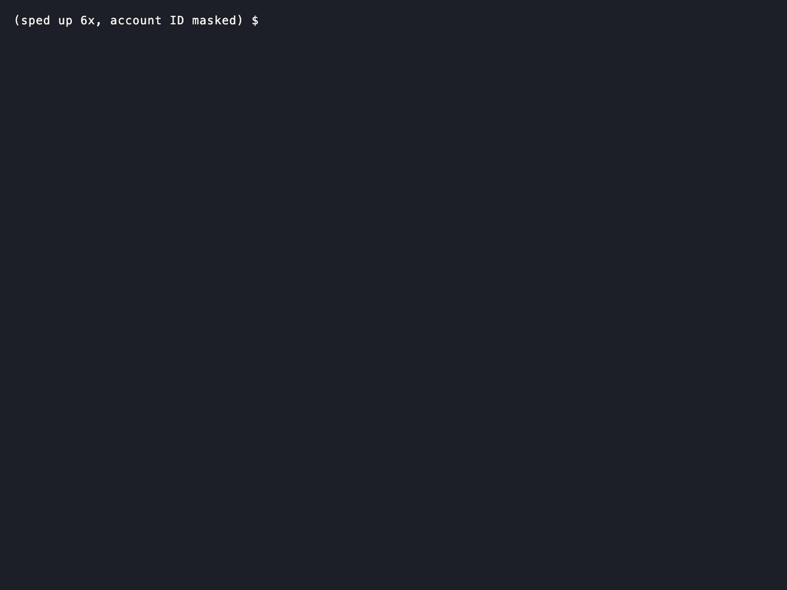

# tfpreflight

tfpreflight checks your Terraform or OpenTofu plan against your real cloud account and tells you what's likely to make `apply` fail, before you run `apply`.



*Real run against AWS. Waiting sped up, account ID masked.*

A plan can look fine and still fail halfway through the apply. The role running it is missing a permission. A name is already taken. A network the plan points at doesn't exist. By then some resources exist and others don't, and you're left cleaning up by hand. tfpreflight looks for these problems in advance, using your plan and read-only calls to your cloud provider, and tells you which parts it couldn't check. It never runs `apply` and never changes anything in your account.

## Status

**Beta.** tfpreflight works provider by provider: it checks the resources of the Terraform providers it has rules for. AWS is the first, and more are on the way.

| Provider | Status |
|---|---|
| AWS | Available now. See [docs/providers/aws/](docs/providers/aws/checks.md). |
| More providers | Not supported yet. [Open an issue](https://github.com/tfpreflight/tfpreflight/issues/new/choose) to tell us which one you need. |

What provider support means, and what happens to resources from other providers: [docs/providers/](docs/providers/README.md).

## Install

**Homebrew** (macOS or Linux). Installs and updates through Homebrew:

```sh
brew install tfpreflight/tap/tfpreflight
```

**Install script** (macOS or Linux). Downloads the latest release, checks it wasn't altered, and puts `tfpreflight` in `/usr/local/bin`, or `~/.local/bin` if that isn't writable. It never uses `sudo`:

```sh
curl -fsSL https://get.tfpreflight.dev/install.sh | sh
```

**Require a signature check.** If you have [cosign](https://docs.sigstore.dev/cosign/system_config/installation/) installed, the script also checks that the release was signed by this project. This option makes it refuse to install without that check:

```sh
curl -fsSL https://get.tfpreflight.dev/install.sh | sh -s -- --require-signature
```

Other options, such as a fixed version or a custom install folder, are in [docs/install.md](docs/install.md).

## Quick start

In a folder with your Terraform files:

```sh
terraform init
terraform plan -out=tfplan
tfpreflight check --plan=tfplan
```

When you run the last command, tfpreflight:

1. Reads the saved plan through `terraform show`. It never changes the plan.
2. Reads which provider versions you use from `.terraform.lock.hcl`, the file `terraform init` writes.
3. Uses your normal cloud credentials (for AWS, the same ones the AWS CLI uses) to make read-only calls: does this name already exist, does this network exist, would this go over a quota.
4. Asks your cloud provider's policy simulator whether the identity that will run the apply is allowed to do each step it knows the permission for. By default that's the identity your provider block assumes, if it assumes one, or else the one you're logged in as. `--principal` names a different one. The simulator doesn't see access rules attached to the resources themselves, so a denial one of them might lift is a warning, not a failure.
5. Prints what it found and exits with a code your scripts can act on (see [Exit codes](#exit-codes)).

Without `--plan`, tfpreflight runs `terraform plan` itself into a temporary file and deletes it afterwards. If you use OpenTofu, it uses `tofu` automatically when your lock file comes from OpenTofu, or you can say `--tool tofu`. Using Terragrunt? Run tfpreflight on the plan Terragrunt produces.

## Example output

**Example: AWS.** A plan that creates an S3 bucket whose name is already taken. S3 bucket names are global across all AWS accounts, so the bucket that has the name may not be yours:

```
tfpreflight · AWS provider 6.64.0 · eu-west-1 · 2 resources

FAIL  aws_s3_bucket.logs
      Bucket name "acme-logs" is already taken.
      Fix: use a different name, or import the existing bucket.

✗ 1 problem will likely make apply fail.
  Checked 2 of 2 resources fully. Details: tfpreflight check --details
```

What each part means:

- **The header** names your provider and its version, the region tfpreflight checked, and how many of that provider's resources the plan changes. If tfpreflight has no rules made for exactly your provider version, a line under it says so, and problems are only warnings.
- **Each problem** is `FAIL` (blocking) or `WARN` (a likely problem), the resource's address, one sentence saying what's wrong, and one `Fix:` or `Check:` line saying what to do.
- **The result line** says how many problems will likely make the apply fail, then how many resources were fully checked: every check that applies to them finished. The exit code here is 1.
- If the cloud checks couldn't run, or your cloud provider answered none of them, the result line starts with `!` and says why. If nothing was found but some resources couldn't be fully checked, a second line says how many.

The default output never shows account IDs or full ARNs. Add `--details` for the full report: the region and identities tfpreflight used, each finding's full explanation, what was not checked, and coverage per check. `--all` adds minor notes to that. `--format=json` gives the same result as JSON. [docs/output.md](docs/output.md) explains every line.

## What the results mean

- **Blocking.** tfpreflight has evidence that the apply would fail at this step: a rule proven against the real cloud, for example that this bucket name is taken, or your cloud provider itself saying no, as with a policy that explicitly denies the call. The run fails (exit code 1).
- **Warning.** Probably a problem, but tfpreflight isn't sure enough to fail the run. Read it before you apply.
- **Couldn't check** (`PARTIAL` in `--details` and JSON). A check started but couldn't finish: no cloud access, a permission tfpreflight itself lacks, or a value Terraform will only know during the apply. This isn't a problem with your plan; it means that part wasn't checked. If the cloud checks could not run at all (for example, no credentials, or a region tfpreflight can't work out), the result says so and why: on AWS, `! AWS checks did not run` (`PARTIAL - AWS checks did not run` in `--details`). If they ran but your cloud provider answered none of their calls (access denied, timeouts), it says so and gives the commonest reason: on AWS, `! AWS checks failed`. If nothing at all could be checked, it says `! Nothing could be checked`. None of these is ever shown as a pass.

**Provider versions.** tfpreflight has rules for specific versions of each provider. On those versions it can block. On any other version it still checks, using the rules of the closest version it knows, but it only warns. For AWS today, that's 61 versions, from 5.98.0 to 6.70.0, with no rules between 5.100.0 and 6.17.0. `tfpreflight version` says the same and lists what it knows, and `tfpreflight update` downloads rules for newer versions. The exact rules are in [docs/output.md](docs/output.md).

A clean result means tfpreflight found no problem in what it checked. It doesn't promise the apply will succeed.

## What it checks

- **Permissions:** whether the identity that runs the apply is allowed to make each call your plan needs, where tfpreflight knows which permission the call takes. Calls it doesn't know are listed under "Not checked" in `--details`; the default output doesn't count those resources as fully checked.
- **Names already taken:** resources whose name must be unique, like S3 buckets and IAM roles on AWS.
- **Missing things your plan depends on:** for example a subnet that points at a network ID that doesn't exist.
- **Limits:** a short list of cloud quotas. On AWS: EC2 vCPUs for one instance type family, and per-region counts such as VPCs.
- **Risky changes:** resources the plan destroys or replaces, and values Terraform will only know during the apply. These come from the plan alone, so they cover every resource, whatever its provider.

More on each check, and on what it doesn't check, is in [docs/checks.md](docs/checks.md). The AWS details, including the exact quota list, are in [docs/providers/aws/checks.md](docs/providers/aws/checks.md).

## Good to know

- **It always tells you what it checked.** Anything it couldn't check is clearly marked, never quietly passed as fine.
- **One account and region per run.** Resources on a second provider block (an "alias", for another region or account) are marked as not checked for now. For AWS, see [docs/providers/aws/limitations.md](docs/providers/aws/limitations.md).
- **Some values only exist during the apply,** like an ID the provider generates. Those can't be checked ahead of time, and tfpreflight says so.

Full details: [docs/limitations.md](docs/limitations.md).

## Safety

- **Read-only.** tfpreflight only reads from your cloud provider, and this is enforced in its code. It makes calls that read, the provider's policy simulator, and, when your provider block assumes a role, the call that assumes it so it can look as that role. On AWS those are Describe, Get, List and similar, the IAM policy simulator, and STS AssumeRole. None of them changes anything. Calls go only to the provider's official addresses, unless you point it elsewhere yourself.
- **What leaves your machine.** Only the read-only calls to your provider, made with your own credentials, and rule downloads when you run `tfpreflight update`. Your plan, results, account IDs and credentials are never sent anywhere else. No usage tracking. See [docs/privacy.md](docs/privacy.md).
- **Signed updates.** Rule downloads are signed. tfpreflight checks the signature and checksum of every file before using it. A download that fails a check is never used.
- **Your plan files.** A temporary plan is always deleted, even if you press Ctrl-C. Pressing Ctrl-C once lets Terraform stop cleanly; pressing it twice stops at once.

To give tfpreflight its own read-only role on AWS, use the policy in [docs/providers/aws/permissions.md](docs/providers/aws/permissions.md).

## Using it in CI

In CI, you usually want "couldn't check" to fail the job too. Otherwise expired credentials would let every change pass. Add this file next to your Terraform files:

```yaml
# .tfpreflight.yml
fail_on_partial: true
```

Then add a step after `terraform plan`:

```yaml
- name: Check the plan
  run: tfpreflight check --plan=tfplan --format=json > tfpreflight.json
```

Don't add `|| true`: the exit code is the result. Full GitHub Actions and GitLab examples for AWS, using short-lived credentials, are in [docs/ci.md](docs/ci.md).

## Configuration

Put `.tfpreflight.yml` in the folder you run tfpreflight from. Every setting is optional:

```yaml
provider_version: 6.64.0   # check against this provider version instead of the lock file's
fail_on: warning           # also fail on warnings (default: error, blocking problems only)
fail_on_partial: true      # also fail when a check couldn't finish (default: false)
```

Command-line flags override the file: `--provider-version`, `--fail-on`, `--fail-on-partial`. A misspelled setting is an error, so a typo never silently falls back to a default. Run `tfpreflight check --help` for every flag.

## Exit codes

| Code | Meaning |
|---|---|
| `0` | Nothing met your failure rule. |
| `1` | Something did: a blocking problem, or a warning or couldn't-check if you turned those on. |
| `2` | tfpreflight couldn't run, for example no plan, no Terraform, or a bad setting. |
| `130` | You pressed Ctrl-C (or CI cancelled the job) twice, so it stopped at once. A single Ctrl-C stops cleanly and exits `2`. |

`tfpreflight update` exits `0` when it has the newest rules and `2` when it couldn't get them.

## Contributing, security and licence

- **Contributing:** see [CONTRIBUTING.md](CONTRIBUTING.md). To report a wrong result, see [docs/reporting.md](docs/reporting.md). To ask for a new provider, [open an issue](https://github.com/tfpreflight/tfpreflight/issues/new/choose).
- **Security:** report vulnerabilities privately as described in [SECURITY.md](SECURITY.md), not in a public issue.
- **Licence:** Apache-2.0, see [LICENSE](LICENSE).